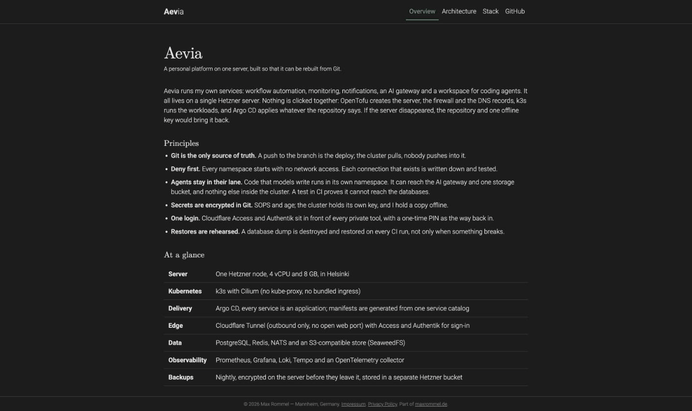
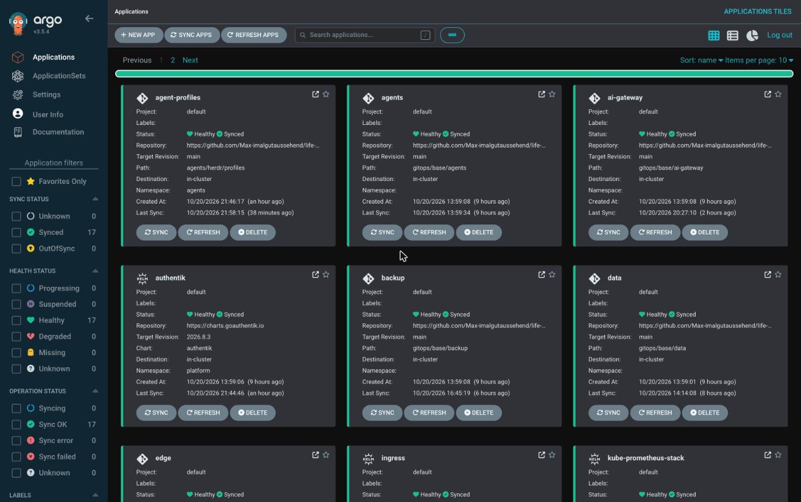
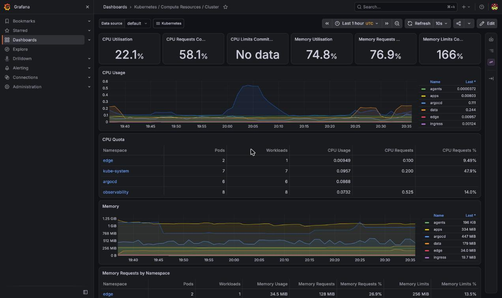
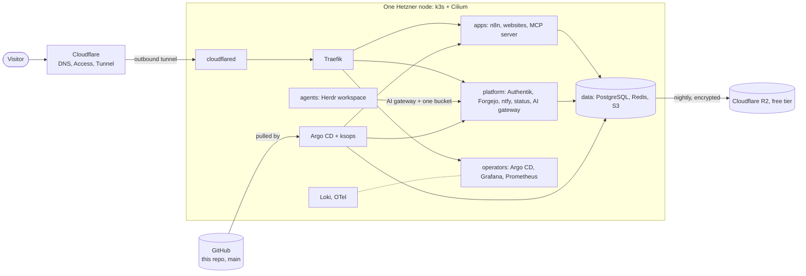

# Aevia

A personal platform on a single server, built so that it can be rebuilt from Git.

Aevia runs my own services (workflow automation, monitoring, notifications, an AI gateway, a git server and a workspace for coding agents) on
one Hetzner machine. Nothing is clicked together: OpenTofu creates the infrastructure, k3s runs the workloads, and Argo CD applies whatever
this repository says.



| Argo CD | Grafana |
|---|---|
|  |  |

Public sites built on it: [aevia.maxrommel.de](https://aevia.maxrommel.de) (what this is) and [maxrommel.de](https://maxrommel.de).

## Principles

1. **Git is the only source of truth.** A push to `main` is the deploy. The cluster pulls; nothing pushes into it.
2. **Deny first.** Every namespace starts with a policy that blocks all traffic; each allowed path is written down and tested.
3. **Agents stay in their lane.** Code that models write runs in the `agents` namespace. It reaches the AI gateway and one storage bucket, and not the databases. CI proves it on a throwaway cluster.
4. **Secrets are encrypted in Git.** SOPS and age; the cluster holds its own key, the operator holds a copy offline.
5. **One login.** Cloudflare Access with Authentik in front of every private tool.
6. **Restores are rehearsed.** A database dump is destroyed and restored in CI, not only when something breaks.

## Architecture



More detail with the reasoning behind each piece: [aevia.maxrommel.de](https://aevia.maxrommel.de/architecture/) and the decision records in [`docs/adr`](docs/adr).

## What runs

| Area | Components |
|---|---|
| Infrastructure | OpenTofu (Hetzner server, firewall; Cloudflare DNS, tunnel, Access), k3s, Cilium |
| Delivery | Argo CD, manifests generated from one service catalog (`catalog/services.yml`), SOPS + age |
| Edge and sign-in | Cloudflare Tunnel and Access, Authentik (OIDC for Cloudflare, Grafana, Argo CD, Forgejo, the MCP server) |
| Data | PostgreSQL, Redis, SeaweedFS (S3) |
| Applications | n8n, Uptime Kuma, ntfy, static websites (each in its own repo), Forgejo (git), an MCP server for claude.ai, the Jarvis voice assistant (brain) |
| AI | FreeLLMAPI gateway (OpenAI and Anthropic wire formats), Herdr agent workspace |
| Observability | Prometheus, Grafana, Loki, OpenTelemetry collector |
| Backup | nightly PostgreSQL dump and gateway volume, encrypted before upload to Cloudflare R2 (stays inside the free tier, guarded) |

## Repository layout

| Path | Purpose |
|---|---|
| `infra/tofu/` | OpenTofu modules and the production environment |
| `catalog/` | the service catalog and its config files; the single input for service manifests |
| `generator/` | `render_k8s.py`: catalog to Deployments, Services, Ingresses and network policies |
| `gitops/` | everything Argo CD applies: `apps/` (one Argo app per area), `base/` (manifests), `platform/` (Helm values), `secrets/` (SOPS) |
| `agents/` | the Herdr workspace image and profile |
| `templates/static-site/` | starting point for a website that lives in its own repository |
| `scripts/` | helpers: secret generation, site updates, validation, port-forwards |
| `tests/` | isolation, restore and smoke tests that run on kind in CI |
| `docs/` | decision records (`adr/`), runbooks, the migration plan |
| `legacy/r1/` | the retired single-server Docker setup (also tagged `release-1`) |

## Adding things

- **A website:** its own repo from `templates/static-site`, then `scripts/site.sh add <name> <repo>`, push, `tofu apply` for the DNS record. See [`docs/runbooks/add-a-site.md`](docs/runbooks/add-a-site.md).
- **A service:** an entry in `catalog/services.yml` with a pinned image digest, `python3 generator/render_k8s.py`, push.
- **A secret:** `sops gitops/secrets/<name>.enc.yaml`, listed in `gitops/secrets/secret-generator.yaml`.

## Checks

```sh
python3 generator/render_k8s.py --check     # generated manifests match the catalog
bash scripts/k8s-validate.sh                # kubeconform, helm template, workload policy, no plaintext secrets
bash tests/isolation/run.sh                 # agents cannot reach PostgreSQL (kind + Cilium)
bash tests/restore/run.sh                   # dump, destroy, restore, S3 refuses anonymous access
bash tests/smoke/run.sh                     # the real manifests start on kind
```

## Run your own

This is a personal platform, not a product: the domain `maxrommel.de`, the Hetzner project and the Cloudflare account are mine. To adapt it you need a
Hetzner Cloud project, a domain on Cloudflare (with R2 for backups and Tofu state), an age key and a GitHub account. Start with
[`docs/runbooks/r2-bring-up.md`](docs/runbooks/r2-bring-up.md); the domain is set in `infra/tofu/environments/production/production.tfvars` and `generator/render_k8s.py`.
Setting up a second development machine: [`docs/runbooks/dev-machine-setup.md`](docs/runbooks/dev-machine-setup.md).

## Related repositories

[`site-aevia`](https://github.com/Max-imalgutaussehend/site-aevia) and [`site-maxrommel`](https://github.com/Max-imalgutaussehend/site-maxrommel) (websites),
[`mcp-obsidian`](https://github.com/Max-imalgutaussehend/mcp-obsidian) (read-only Obsidian MCP server).

## License

[Apache License 2.0](LICENSE).
